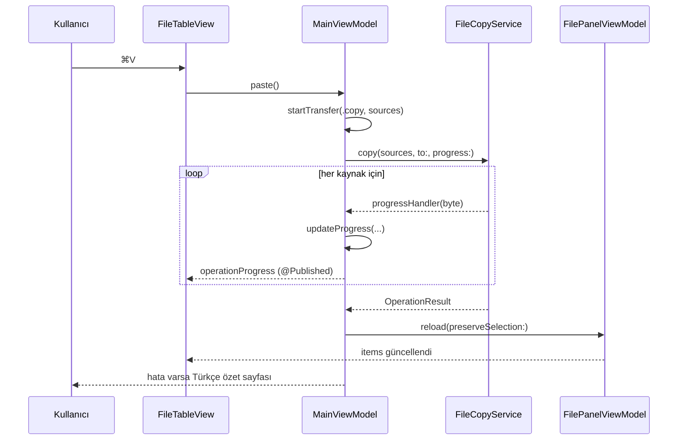

# GMS Commander — Mimari

Bu belge modülleri, veri akışını ve arayüz–servis ilişkilerini açıklar. Tüm kod Swift 5 dil
sürümüyle, SwiftUI + AppKit karışımı olarak yazılmıştır; minimum hedef macOS 14.0 / arm64.

## 1. Katmanlar

```
┌──────────────────────────────────────────────────────────────┐
│  Views (SwiftUI + AppKit)                                    │
│  Views (SwiftUI + AppKit, + NSTableView)                     │
│  MainWindowView · FilePanelView · FileTableView              │
│  Dialogs · SettingsView · Theme · MenuCommands               │
└───────────────▲──────────────────────────┬───────────────────┘
                │ @Published / ObservableObject
┌───────────────┴──────────────────────────▼───────────────────┐
│  ViewModels                                                  │
│  MainViewModel (orkestrasyon)                                │
│  FilePanelViewModel (panel durumu)                           │
│  FileOperationViewModel (ilerleme sunumu)                    │
└───────────────▲──────────────────────────┬───────────────────┘
                │ modeller                     │ çağrılar
┌───────────────┴──────────────────────────▼───────────────────┐
│  Services                                                    │
│  FileManagerService · FileCopyService · FileMoveService      │
│  FileSearchService · FileWatcherService · SettingsStore      │
│  GitService · QuickLookCoordinator · TerminalService         │
└──────────────────────────────────────────────────────────────┘
                │
┌───────────────▼──────────────────────────────────────────────┐
│  Models: FileItem · DirectorySnapshot · FileOperation        │
│          FileProperties                                      │
│  Utilities: biçimlendiriciler, hata metinleri, L.t, kısayollar│
└──────────────────────────────────────────────────────────────┘
```

Bağımlılık yönü tek yönlüdür: **Views → ViewModels → Services → Models/Utilities**.
Servisler arayüzü tanımaz; ViewModels AppKit'e yalnızca Quick Look, olay izleme ve
pano gibi zorunlu köprülerde dokunur.

## 2. Modeller

| Tip | Sorumluluk |
|---|---|
| `FileItem` | Tek bir dosya/klasörün adı, URL'si, türü, boyutu, tarihi, gizlilik ve bağlantı bilgisi. `make(url:relativePath:)` tek giriş noktasıdır. `sorted(_:by:ascending:foldersFirst:)` sıralama kurallarını (Türkçe `localizedStandardCompare`) uygular. |
| `DirectorySnapshot` | Bir klasörün öğe listesi + klasör/dosya sayıları. `item(at:)` seçim geri yüklerken standartlaştırılmış yol karşılaştırması yapar. |
| `OperationKind` / `OperationProgress` | İşlem türü ve ilerleme (öğe sayısı, bayt, oran). `fraction` bayt bilinmiyorsa öğe sayısına düşer. |
| `ConflictPolicy` / `ConflictDecision` | Çakışma politikası (`ask`, `overwrite`, `skip`, `keepBoth`) ve tek öğe kararı. |
| `FileOperationFailure` / `OperationResult` | İşlem sonucu: tamamlanan sayı, Türkçe hata listesi, iptal bilgisi. |
| `FileProperties` | Özellikler penceresi verisi; klasör toplam boyutu isteğe bağlı hesaplanır. |

## 3. Servisler

| Servis | Görev | Notlar |
|---|---|---|
| `FileManagerService` | Listeleme, yeniden adlandırma, klasör oluşturma, Çöp Kutusu'na taşıma/kalıcı silme, benzersiz ad üretme, kök klasör/aynı konum testleri | Ad doğrulama (`/` ve `:` yasak), yerelleştirilmiş hata fırlatma (`FileOperationError`). |
| `FileCopyService` | Kopyalama; ilerleme geri çağrısı, iptal, çakışma kararı, sembolik bağ kopyalama | `copySync` ve `Task.detached(priority:)` ile arka planda; bayt sayacı atomik olarak toplanır. |
| `FileMoveService` | Taşıma; aynı diskte `moveItem`, diskler arası otomatik kopyala+sil (EXDEV) | `estimateSync` ile taşımadan önce boyut tahmini. |
| `FileSearchService` | Alt klasörlerde arama, gizli dosya seçeneği, sonuç sınırı | Türkçe duyarsız normalizasyon: `en_US_POSIX` katlama + `ı→i` (Türkçe yerelde `I → ı` olduğu için özel). |
| `FileWatcherService` | Klasörü FSEvents ile izler, değişimde paneli yeniler | `refreshAutomatically` ayarıyla kapatılabilir; panel başına tek akış. |
| `SettingsStore` | Kalıcı ayarlar (`UserDefaults`), panel yolları, çakışma politikası | `init(defaults:)` ile testlerde izole `UserDefaults(suiteName:)` enjekte edilebilir. |
| `GitService` | Dal adı ve değişiklik sayısı | `/usr/bin/git` süreç çağrısı; git yoksa sessizce devre dışı. |
| `QuickLookCoordinator` | `QLPreviewPanel` veri kaynağı ve temsilcisi | Panel kapatılınca seçim korunur. |

## 4. ViewModel'ler

### `FilePanelViewModel` (panel başına bir tane)

- Durum: `currentDirectory`, `snapshot`, `items`, `selection`, `sortKey`, `sortAscending`, `isLoading`,
  `alert`, `gitStatus`, arama durumu; gezinme geçmişi `backStack` / `forwardStack` özel yığınlarında tutulur.
- `reload(preserveSelection:)` klasörü `FileManagerService` üzerinden okur, gizli dosya filtresini ve
  sıralamayı uygular; seçimi standartlaştırılmış yol ile geri yükler.
- `navigate(to:)`, `goUp()`, `goBack()`, `goForward()`, `goHome()` gezinme geçmişini yönetir.
- `itemCountText`, `selectionText`, `selectionSizeText`, `freeSpaceText`, `displayPath` gibi
  hesaplanmış metinler durum çubuğunu ve panel alt bilgisini besler.

### `MainViewModel` (tek örnek)

- İki `FilePanelViewModel` sahibi; `activeSide` ile hangi panelin etkin olduğunu tutar.
- Pano: `clipboardSources` + `clipboardMode` (kopyala/kes). Yapıştırma hedefi etkin panelin klasörüdür.
- İşlem kuyruğu: aynı anda tek `operationTask`; `operationProgress` yayınlandıkça ilerleme şeridi güncellenir.
- Çakışma akışı: `pendingConflict` yayınlanır → `ConflictSheet` kullanıcıdan karar alır →
  `resolveConflict(_:)` bekleyen işlemi sürdürür.
- Silme: varsayılan `Çöp Kutusu`; `deletionRequest` ile kalıcı silme onayı.
- Panellere yapılan her değişiklik `objectWillChange` birleştirmesiyle araç çubuğuna ve durum çubuğuna yansır.
- `isModalPresented`: açık bir sayfa (sheet) varsa yalın tuş yönlendirmesini kapatır.

### `FileOperationViewModel`

`OperationProgress` verisini ilerleme şeridinin metinlerine çeviren sunucu: başlık, geçerli öğe,
oran, yüzde metni ve bayt metni. Görünüm katmanı biçimlendirme yapmaz.

## 5. Arayüz

- **MainWindowView**: araç çubuğu + `HSplitView` içinde iki `FilePanelView` + ilerleme şeridi + durum çubuğu +
  `FunctionKeyBar` (F3–F10). `defaultSize` 1240×780, `minWidth` 960 / `minHeight` 600.
  `MainWindowView.perform(_:on:)` statik yönlendiricisi hem menüden, hem işlev tuşu şeridinden,
  hem `KeyboardEventRouter`'dan gelen eylemleri tek yerde çözer.
- **FilePanelView**: panel başlığı (`SOL`/`SAĞ` rozeti, monospaced yol, geri/ileri/üst düğmeleri, arama alanı),
  dosya tablosu, NC tarzı alt bilgi. Etkin panel mavi çerçeve ve parlak zeminle vurgulanır.
- **FileTableView** (`NSViewRepresentable` + `NSTableView`): `Ad / Tür / Boyut / Tarih` sütunları,
  20 pt satır yüksekliği, klasörler mavi, seçim beyaz zemin. Seçim AppKit'in kendi `mouseDown`
  yolundan yönetilir; `tableViewSelectionDidChange` → `panel.setSelection`, SwiftUI → AppKit yönü
  `revision` + `isApplyingSelection` ile kilitlenir. Çift tıklama `viewModel.open`, sağ tık menüsü
  (Aç, Hızlı Önizleme, Birlikte Aç, Kopyala/Kes/Yapıştır, **Yeni Klasör**, **Terminal'de Aç**,
  Yeniden Adlandır, Yol Kopyala, Özellikler, Finder, Yenile, Gizli) koordinatörün `NSMenuDelegate`
  uygulamasıyla kurulur. `FileListNSTableView` alt sınıfı boş alana tıklamada seçimi temizler ve
  sağ tıklanan satırı önce seçer.
- **Theme**: `Palette` (NSColor) ve `Theme` (SwiftUI `Color`) sabit koyu paleti; tüm görünümler ve
  tablo hücreleri renklerini buradan alır. Açık/koyu sistem temasından bağımsızdır.
- **TerminalService**: `resolvedDirectory(for:)` klasör/dosya yolundan açılacak klasörü çözer,
  `open(at:)` `/usr/bin/open -a Terminal <yol>` ile yeni pencere açar. `isAvailable` Terminal kurulu mu?
- **Dialogs**: `RenameSheet`, `PropertiesSheet`, `ConflictSheet`, `HelpView`. Kalıcı silme onayı ve hata
  bildirimleri `MainWindowView` içindeki `.alert`/`.confirmationDialog` sunumlarıyla gösterilir.
- **SettingsView**: gizli dosyalar, klasörler önce, çakışma politikası, otomatik yenileme, arama yolu, Git entegrasyonu;
  ayrı bir `Settings` sahnesi olarak `⌘,` ile açılır.
- **MenuCommands**: tüm menü öğeleri ve `⌘` kısayolları; `F5`/`F6` için `KeyEquivalent(Character("\u{F708}"/"\u{F709}"))`.

### Yalın tuş ve işlev tuşu yönlendirmesi

`Space`, `Return`, `Backspace` ve `F3`–`F10` menü kısayolu değildir. `KeyboardEventRouter` yerel bir
`NSEvent` izleyicisi kurar ve olayı `KeyCommand.bare(...)` / `KeyCommand.function(...)` olarak
sınıflandırır. İlk yanıtlayıcı bir metin alanıysa (arama, adres çubuğu, yeniden adlandırma) yalnızca
**yalın** tuşlar geçirilir; işlev tuşları yazı yazılırken de çalışır çünkü F3–F10 metin üretmez.
Sayfa (sheet) açıkken tüm yönlendirme durur.

İşlev tuşu eşlemesi (`KeyboardShortcutManager.functionKeyAction`):

| Tuş | keyCode | Eylem |
|---|---|---|
| F3 | 99 | `view` (Quick Look) |
| F4 | 118 | `openWith` |
| F5 | 96 | `copy` |
| F6 | 97 | `move` |
| F7 | 98 | `newFolder` |
| F8 | 100 | `delete` |
| F9 | 101 | `terminal` |
| F10 | 109 | `quit` |

Değiştirici tuş (⌘/⌥/⌃) basılıyken işlev tuşu eşlemesi devre dışıdır.

### Yalın tuş eşlemesi

| Tuş | keyCode | Eylem |
|---|---|---|
| Space | 49 | `quickLookSelection()` |
| Return / Enter | 36 / 76 | `openSelection()` |
| Backspace | 51 | `goUp()` |

## 6. Veri akışı — kopyalama örneği



## 7. Yerelleştirme

- Tüm görünen metinler `L.t("anahtar")` üzerinden gelir (200 anahtar, `tr.lproj/Localizable.strings`).
- `L.t` önce `Bundle.main/tr.lproj/Localizable.strings` dosyasını doğrudan okur; böylece sistem dili
  Türkçe olmasa da arayüz Türkçe kalır. Paket yoksa (test koşucusu) anahtarın kendisi döner.
- Biçimlendirilmiş metinlerde `String(format:locale:)` `tr_TR` yereliyle çalışır (ondalık virgül).

## 8. Eşzamanlılık ve hatalar

- Servisler `async` API ve `@Sendable` ilerleme geri çağrıları sunar; uzun işler `Task.detached(priority: .utility)`.
- İptal: `operationTask.cancel()` + servis içinde `Task.isCancelled` denetimi; sonuç `wasCancelled` ile raporlanır.
- Tüm kullanıcı hataları `FileOperationError` üzerinden Türkçe başlık + açıklamaya çevrilir (`ErrorMessages`).
- Çöp Kutusu'na taşıma `FileManager.trashItem` ile yapılır; geri alınabilir.

## 9. Bilinçli sapmalar

| Talimat dosyası | Uygulamadaki durum | Gerekçe |
|---|---|---|
| `ViewModels/FileOperationViewModel.swift` | Var; ilerleme **sunumu** yapar, işlem durumunun sahibi `MainViewModel`'dir | Tek doğruluk kaynağı; SwiftUI'da iç içe `ObservableObject` yayılımı kırılgan. |
| `Utilities/KeyboardShortcutManager.swift` | Var; kısayol kataloğu + yalın tuş yönlendiricisi | Hem yardım ekranını hem Space/Return/Backspace davranışını besler. |
| `DateFormatterHelper`, `FileIconProvider`, `FileKindProvider`, `PermissionsFormatter`, `ErrorMessages`, `Localized` | Talimatta listelenmeyen ek yardımcı dosyalar | Sorumlulukları tek yerde toplamak için. |
| `GitService`, `QuickLookService`, `TerminalService` | Talimat dışı ek özellikler | İstenen "modern macOS" deneyimi, hızlı önizleme ve Terminal entegrasyonu. |
| `Utilities/Theme.swift` | Talimat dışı ek dosya | Norton Commander görünümü için renklerin tek kaynağı; görünümlerde sabit renk yok. |
| `Views/FileTableView.swift` | Talimattaki `Views/FileListView.swift` yerine | `List(selection:)` + çift tıklama tanıyıcısı seçim hatasına yol açıyordu; AppKit tablosu seçimi güvenilir yönetir. |
